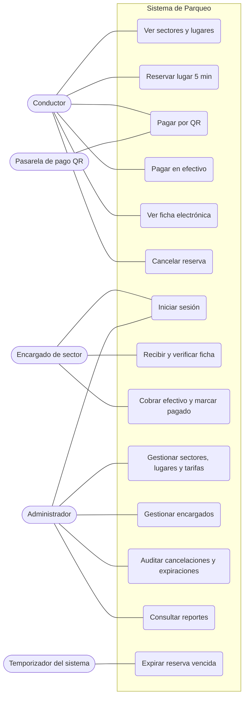

# Casos de uso – Sistema de Parqueo Tarija

Basado en los actores definidos (rama `actores`) y en los requerimientos funcionales (`requisitos/requerimientos-funcionales.md`).

## Diagrama general

## Detalle de los casos de uso principales

| ID | Caso de uso | Actor | Requerimientos | Resumen |
|---|---|---|---|---|
| CU-01 | Ver sectores y lugares | Conductor | RF-01 a RF-04 | Sin login, ve los sectores y el estado de sus 20 lugares (libre, reservado, ocupado). |
| CU-02 | Reservar lugar | Conductor | RF-05 a RF-07, RF-36 | Elige un lugar libre; queda reservado 5 minutos y nadie más puede tomarlo. |
| CU-03 | Pagar por QR | Conductor, pasarela | RF-08, RF-09, RF-11, RF-12, RF-39 | Se genera el QR; al confirmarse el pago se emite la ficha. |
| CU-04 | Pagar en efectivo | Conductor | RF-08, RF-10, RF-12 | Elige efectivo; se emite la ficha y el encargado cobra en el lugar. |
| CU-05 | Ver ficha | Conductor | RF-12, RF-15 | Consulta su ficha con código único, sector, lugar, monto y método. |
| CU-06 | Cancelar reserva | Conductor | RF-13 | Cancela dentro de los 5 minutos y el lugar se libera. |
| CU-07 | Iniciar sesión | Encargado, administrador | RF-16, RF-26 | Ingresa con usuario y contraseña. |
| CU-08 | Recibir y verificar ficha | Encargado | RF-19 a RF-21, RF-23 | Recibe la ficha solo cuando se pagó o se eligió efectivo y la compara con la del conductor. |
| CU-09 | Cobrar efectivo y marcar pagado | Encargado | RF-21, RF-22 | Registra el cobro y marca el sitio como pagado. |
| CU-10 | Gestionar sectores, lugares y tarifas | Administrador | RF-27, RF-28, RF-40 | Crea, edita y desactiva sectores y lugares; define la tarifa. |
| CU-11 | Gestionar encargados | Administrador | RF-29, RF-30 | Crea, edita y desactiva encargados y los asigna a un sector. |
| CU-12 | Auditar cancelaciones | Administrador | RF-31, RF-32, RF-38 | Revisa cancelaciones y expiraciones con fecha, sector, lugar y motivo. |
| CU-13 | Consultar reportes | Administrador | RF-33 a RF-35 | Ingresos, ocupación y cobros QR vs efectivo, exportables. |
| CU-14 | Expirar reserva vencida | Temporizador | RF-14, RF-38 | Si pasan 5 minutos sin pagar, cancela la reserva y libera el lugar. |

## Fichas de los casos de uso del conductor

### CU-02 Reservar lugar
- **Precondición:** el lugar está libre y el sector tiene una tarifa vigente.
- **Flujo principal:** 1) el conductor elige sector y lugar; 2) el sistema reserva el lugar 5 minutos; 3) muestra el contador y el monto.
- **Flujo alterno:** otro conductor lo reservó antes, el sistema responde que el lugar no está disponible (409).
- **Postcondición:** el lugar queda `RESERVADO`.

### CU-03 Pagar por QR
- **Precondición:** reserva activa y dentro de los 5 minutos.
- **Flujo principal:** 1) elige QR; 2) el sistema genera el código; 3) la pasarela confirma el pago; 4) se emite la ficha y llega al encargado.
- **Flujo alterno:** la confirmación llega con la reserva vencida, el pago no se aplica.
- **Postcondición:** reserva `PAGADA`, lugar `OCUPADO`, ficha `EMITIDA`.

### CU-06 Cancelar reserva
- **Precondición:** reserva `ACTIVA` y dentro de los 5 minutos.
- **Flujo principal:** el conductor cancela; el lugar se libera y se registra la cancelación.
- **Flujo alterno:** ya pagó o ya expiró, el sistema no permite cancelar.
