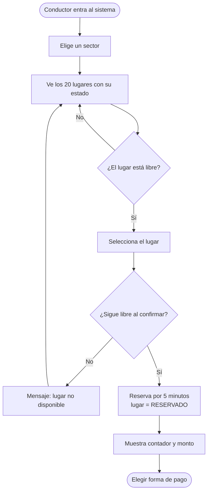
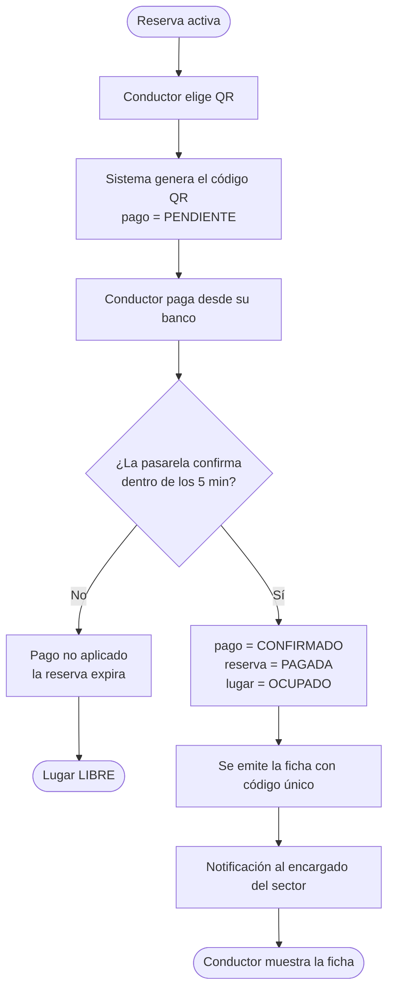
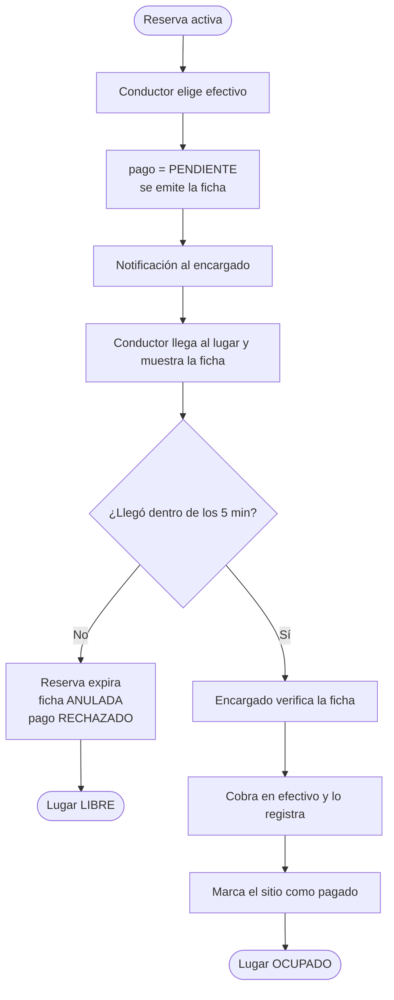
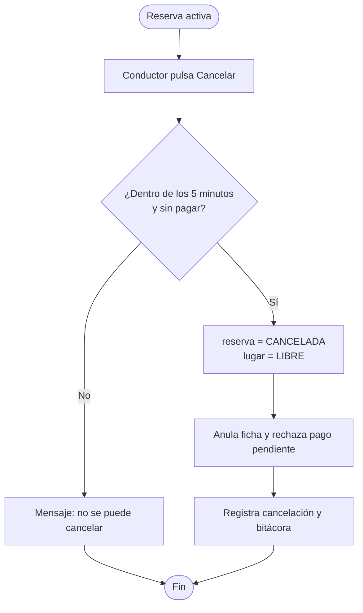
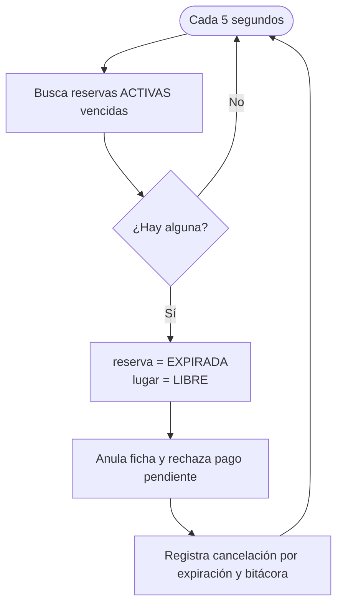
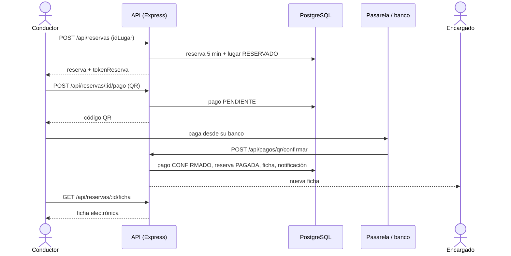

# Diagramas de flujo – Sistema de Parqueo Tarija

Los diagramas usan Mermaid y se ven directamente en GitHub.

## 1. Reserva de un lugar

## 2. Pago por QR

## 3. Pago en efectivo

## 4. Cancelación por el conductor

## 5. Expiración automática

## 6. Secuencia del pago por QR

