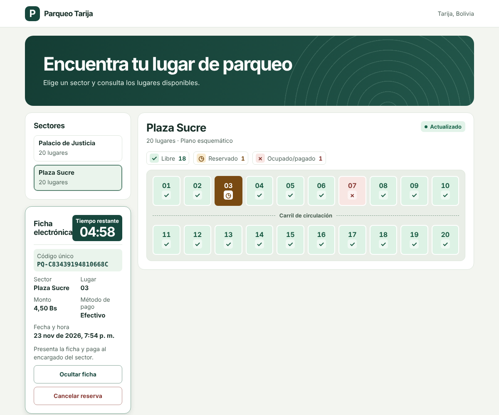

# Integración frontend y backend (22 de noviembre)

El frontend público del Trío A (`frontend/`, React + Vite) se conecta con la API del Trío B. Esta página resume cómo se conectan y qué se probó.

## Cómo se conectan
- En desarrollo, Vite reenvía `/api` a la API con un proxy. El destino se cambia con `API_PROXY_TARGET` en `frontend/.env.local` (por defecto `http://127.0.0.1:3000`).
- En producción, el frontend y la API deben servirse desde el mismo origen. Si están separados, se define `VITE_API_URL` al compilar el frontend y `CORS_ORIGIN` en el `.env` de la API.
- Todas las respuestas de la API usan `{ ok, mensaje, datos }`. El frontend lee `datos` y muestra `mensaje` cuando hay un error.
- El conductor no inicia sesión: guarda el `id` y el `tokenReserva` de su reserva y los envía en el header `x-reserva-token`.

## Cómo levantar todo
1. PostgreSQL con la base `parqueo_tarija` cargada con `backend/db/schema.sql`.
2. API: `cd "AVANCE TRÍO B/backend"`, `npm install`, `npm run dev` (necesita su `.env`).
3. Frontend: `cd frontend`, `npm ci`, `npm run dev`, y abrir `http://localhost:5173`.

## Qué se probó
Se abrió el frontend real en un navegador (Chromium) contra la API real y una base PostgreSQL 16:

| Prueba | Resultado |
|---|---|
| Carga de sectores y plano de 20 lugares | Correcto |
| Elegir un lugar libre y reservarlo (`POST /api/reservas`) | 201; el panel muestra el contador desde 04:59 y el monto |
| El monto refleja la tarifa vigente | Correcto: 4,50 Bs después de que el administrador cambió la tarifa |
| Pagar en efectivo (`POST /api/reservas/:id/pago`) | 201; se muestra la ficha con su código único |
| Pagar por QR | Se muestra la imagen del QR |
| Confirmación del banco (`POST /api/pagos/qr/confirmar`) | El frontend detecta la ficha en menos de 5 segundos y el plano pasa a "Ocupado/pagado" |
| Cancelar la reserva desde la pantalla | El lugar se libera y el contador de reservados baja |
| Dos conductores al mismo lugar | El primero recibe 201 y el segundo 409 |

## Observaciones
- Mientras se espera el pago por QR, el frontend consulta `GET /api/reservas/:id/ficha` cada 2 segundos y la API responde **404** hasta que la ficha existe. Es lo esperado y aparece en la consola del navegador. Si se quisiera evitar ese ruido, la API podría responder 200 con `datos: null`, pero habría que adaptar el frontend.
- Falta el frontend del encargado y del administrador. La API ya está lista (`/api/encargado/...` y `/api/admin/...`) y la sesión usa `Authorization: Bearer <token>`.
