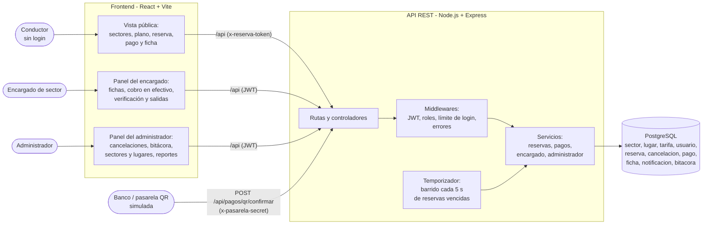
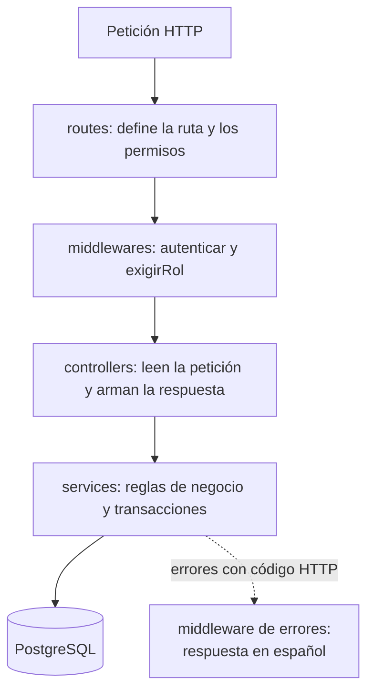

# Arquitectura del sistema

Los diagramas usan Mermaid y GitHub los dibuja al abrir el archivo.

## Vista general

## Capas del backend

## Seguridad
- **Conductor:** no tiene cuenta. Cada reserva trae un `tokenReserva` firmado (HMAC) que se envía en el header `x-reserva-token`.
- **Encargado y administrador:** inician sesión con usuario y contraseña (bcrypt) y reciben un JWT (`Authorization: Bearer`). Cada petición comprueba que el usuario siga activo.
- **Banco:** la confirmación del pago QR exige un secreto compartido (`x-pasarela-secret`).
- **Datos:** todas las consultas SQL son parametrizadas; la hora es la de Bolivia (UTC−4).
