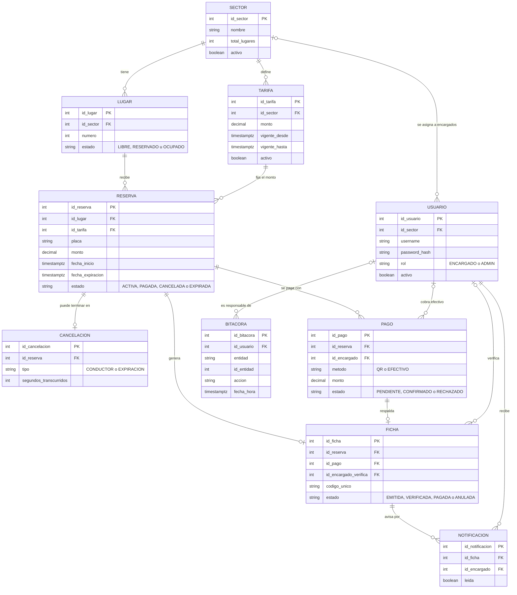
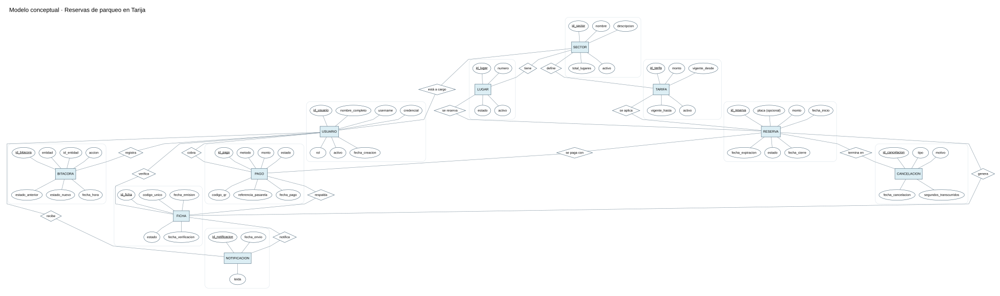
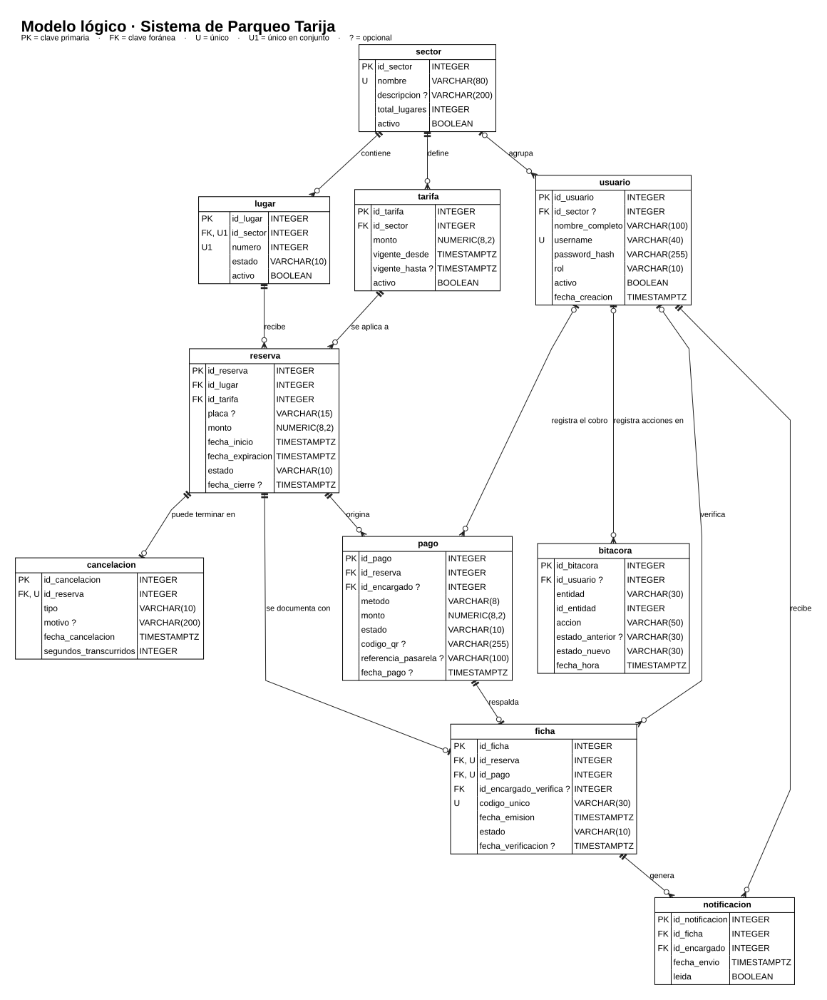

# Modelo de la base de datos (PostgreSQL)

## Diagrama entidad-relación

Generado a partir de `AVANCE TRÍO B/backend/db/schema.sql`. Solo se muestran las columnas principales.

## Reglas que garantiza la base de datos
- Un lugar no puede tener dos reservas activas a la vez (índice único parcial `uk_reserva_lugar_activa`).
- Una reserva tiene como máximo una cancelación y una ficha, y el código de la ficha es único.
- Un encargado siempre pertenece a un sector (`chk_usuario_encargado_sector`).
- Los estados y métodos solo admiten los valores indicados (restricciones `CHECK`).

## Modelos entregados por el Trío A
| Modelo | Archivo |
|---|---|
| Conceptual | [`base-de-datos/diagrama-conceptual.svg`](base-de-datos/diagrama-conceptual.svg) |
| Lógico | [`base-de-datos/modelo-logico.svg`](base-de-datos/modelo-logico.svg) |
| Físico (script SQL) | [`base-de-datos/modelo-fisico-postgresql.sql`](base-de-datos/modelo-fisico-postgresql.sql) |

